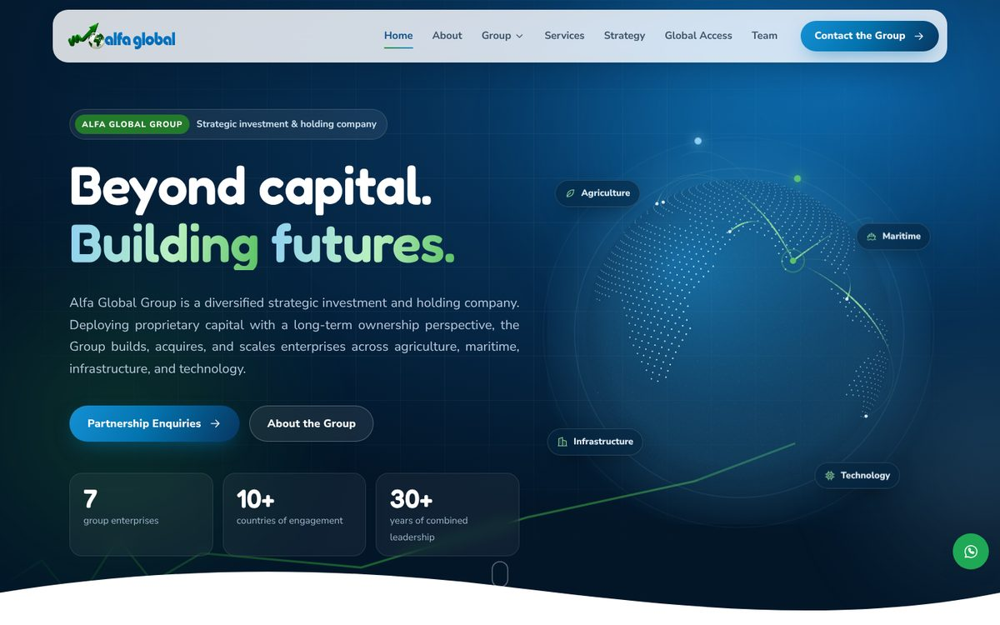
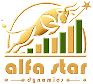
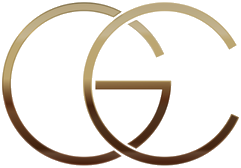
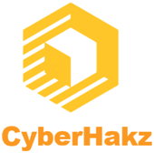
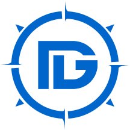
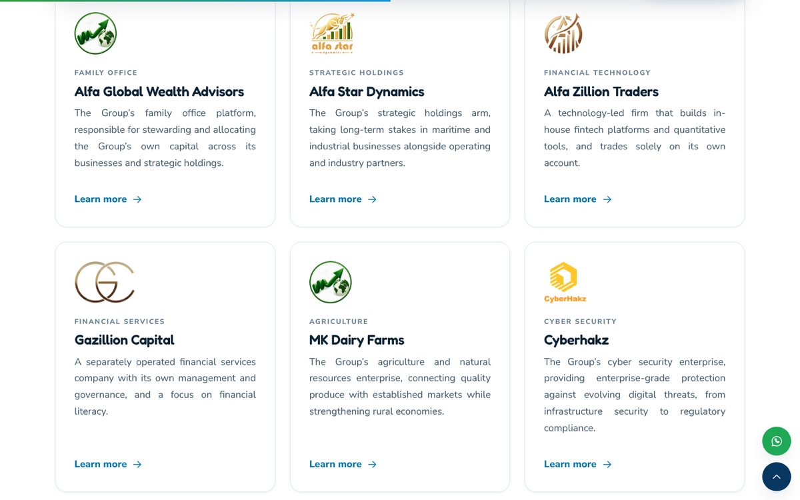
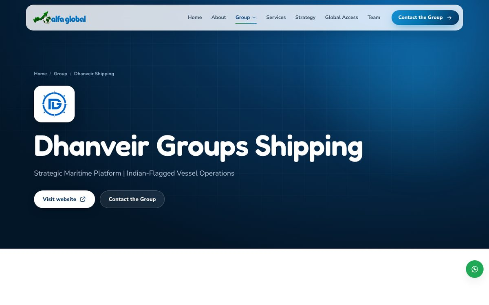
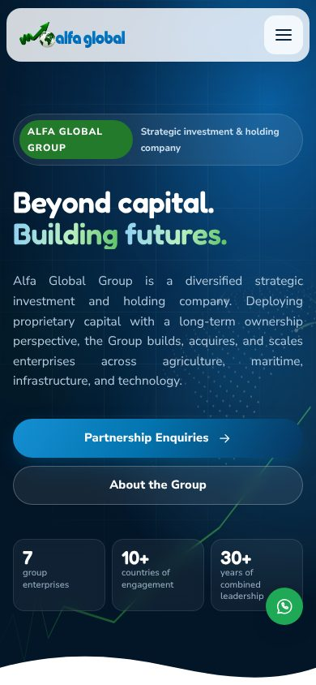

<div align="center">


### Beyond capital. Building futures.

**A diversified strategic investment and holding company, building enduring enterprises across generations.**

<br>


[**Website**](https://alfaglobalwealth.com) · [The Group](#-who-we-are) · [Enterprises](#-the-group-enterprises) · [Strategy](#-how-the-group-invests) · [Contact](#-contact) · [Run the site](#-about-this-website)

<br>



</div>

---

## 🌍 Who we are

**Alfa Global Group** is a diversified strategic investment and holding company founded on a vision of global transformation, innovation and lasting impact. Headquartered in **Chennai, India**, the Group deploys its **own proprietary capital** into transformative ideas, strategic ventures and high-impact projects that shape industries and create sustainable value across generations.

Spanning strategic holdings and joint ventures, as well as projects in **infrastructure, maritime, manufacturing, agriculture and technology**, the Group's activities reflect an enduring commitment to building institutions of lasting value. It measures success not by financial outcomes alone, but by its capacity to foster innovation, empower communities and leave a lasting legacy.

<table>
<tr>
<td width="50%" valign="top">

### 🔭 Our vision

To be a global catalyst for transformation, shaping industries, strengthening legacies and creating sustainable value that transcends generations.

</td>
<td width="50%" valign="top">

### 🎯 Our mission

To deploy the Group's proprietary capital into transformative ideas, strategic ventures and high-impact projects that drive innovation and growth across industries, and to build enduring value alongside its enterprises, partners and communities.

</td>
</tr>
</table>

---

## 🏢 The Group enterprises

Each enterprise is run by its own management and backed by the Group's long-term ownership.

<table>
<tr>
<td align="center" width="140"></td>
<td><b>Alfa Global Wealth Advisors</b><br><sub>FAMILY OFFICE</sub><br>The Group's family office platform, responsible for stewarding and allocating the Group's own capital across its businesses and strategic holdings.<br><a href="https://alfaglobalwealth.com/">alfaglobalwealth.com</a></td>
</tr>
<tr>
<td align="center"></td>
<td><b>Alfa Star Dynamics</b><br><sub>STRATEGIC HOLDINGS</sub><br>The Group's strategic holdings arm, taking long-term stakes in maritime and industrial businesses alongside operating and industry partners.<br><a href="https://alfastardynamics.com/">alfastardynamics.com</a></td>
</tr>
<tr>
<td align="center"></td>
<td><b>Alfa Zillion Traders</b><br><sub>FINANCIAL TECHNOLOGY</sub><br>A technology-led firm that builds in-house fintech platforms and quantitative tools, and trades solely on its own account.<br><a href="https://alfazillion.com/">alfazillion.com</a></td>
</tr>
<tr>
<td align="center"></td>
<td><b>Gazillion Capital</b><br><sub>FINANCIAL SERVICES</sub><br>A separately operated financial services company with its own management and governance, and a focus on financial literacy.<br><a href="https://www.gazcap.com/">gazcap.com</a></td>
</tr>
<tr>
<td align="center"></td>
<td><b>MK Dairy Farms</b><br><sub>AGRICULTURE</sub><br>The Group's agriculture and natural resources enterprise, connecting quality produce with established markets while strengthening rural economies.<br><a href="https://mkdairyfarms.com/">mkdairyfarms.com</a></td>
</tr>
<tr>
<td align="center"></td>
<td><b>Cyberhakz</b><br><sub>CYBER SECURITY</sub><br>The Group's cyber security enterprise, providing enterprise-grade protection against evolving digital threats, from infrastructure security to regulatory compliance.<br><a href="https://cyberhakz.com/">cyberhakz.com</a></td>
</tr>
<tr>
<td align="center"></td>
<td><b>Dhanveir Groups Shipping</b><br><sub>MARITIME</sub><br>The Group's strategic maritime platform, established to build, own and operate Indian-flagged vessels across key cargo segments, including dry bulk.<br><a href="https://www.dhanveirgroups.com/">dhanveirgroups.com</a></td>
</tr>
</table>

<div align="center">

</div>

---

## 🧭 How the Group invests

| | Pillar | What it means |
| :-: | --- | --- |
| **01** | **Diversification for stability** | A balanced presence across strategic holdings, maritime, sustainable agriculture, infrastructure and cyber security underpins the Group's resilience. |
| **02** | **Disciplined opportunity selection** | Identifying opportunities early, and committing where the Group can contribute capital, expertise and strategic partnerships. |
| **03** | **Innovation and technology** | Technology platforms, data and digital tools embedded across the enterprises to strengthen efficiency, transparency and decisions. |
| **04** | **Global expansion, local impact** | A presence across domestic and international markets, with a focus on industries that strengthen communities. |
| **05** | **Responsibility and governance** | Sound governance and responsible stewardship, with growth aligned to environmental and social responsibility. |

### ✨ The Alfa Global distinction

<table>
<tr>
<td align="center" width="25%"><h3>💠</h3><b>Capital</b><br><sub>A long horizon, supported entirely by proprietary capital.</sub></td>
<td align="center" width="25%"><h3>💡</h3><b>Insight</b><br><sub>Deep sector knowledge and operating experience.</sub></td>
<td align="center" width="25%"><h3>📈</h3><b>Opportunities</b><br><sub>Ventures in sectors where the Group already has strength.</sub></td>
<td align="center" width="25%"><h3>⚡</h3><b>Execution</b><br><sub>Experienced leadership and an international network.</sub></td>
</tr>
</table>

**Our values:** Excellence · Integrity · Innovation · Partnership · Impact · Vision

---

## 🖥️ A look at the website

<table>
<tr>
<td width="68%"></td>
<td width="32%" align="center"></td>
</tr>
<tr>
<td align="center"><sub>Every enterprise has its own page</sub></td>
<td align="center"><sub>Designed for every screen, from phones to ultra-wide</sub></td>
</tr>
</table>

---

## 📬 Contact

**Alfa Global Group: Chennai (HQ)**
No. 6/8, Second Floor, Lakshmi Nagar, 10th Street, Nanganallur, Chennai 600 061, India

✉️ [contact@alfaglobalwealth.com](mailto:contact@alfaglobalwealth.com) &nbsp;·&nbsp; 🌐 [alfaglobalwealth.com](https://alfaglobalwealth.com)

The Group welcomes dialogue with founders, promoters and strategic partners whose enterprises or projects align with its long-term investment focus.

> [!IMPORTANT]
> Alfa Global Group invests only its own capital. It does not provide investment advice, portfolio management, research recommendations or broking services, and does not accept money from the public for investment. Nothing in this repository or on the website is an offer, solicitation or recommendation to buy or sell any security or financial product. Group companies that carry on any regulated activity do so separately, under their own registrations where applicable.

---

## 🛠️ About this website

The Alfa Global Group website is a single Rust binary. Every page is rendered on the server with [Axum](https://github.com/tokio-rs/axum) and [Askama](https://github.com/djc/askama) templates, and the Team and Services pages are read live from NocoDB. There is no Node build step: the CSS and JavaScript in `static/` are hand-written and served as they are.

### Quick start with Docker

```bash
cp .env.example .env          # skip if you already have .env
# edit .env: set NOCODB_URL (and NOCODB_API_TOKEN if it is empty)
docker compose up -d --build
open http://localhost:8080
```

The container is a distroless image running as a non-root user, with a
built-in health check. Contact-form enquiries are written to the `enquiries`
volume (`/data/enquiries.jsonl`).

Without Compose:

```bash
docker build -t alfa-global-site .
docker run -d -p 8080:8080 --env-file .env -v alfa-data:/data alfa-global-site
```

### Running locally

Requires a recent stable Rust toolchain (`rustup update stable`).

```bash
cargo run            # http://localhost:8080
cargo test           # unit tests for the NocoDB field mapping
```

### Settings (`.env`)

| Variable | Purpose | Default |
| --- | --- | --- |
| `NOCODB_URL` | NocoDB server address, without a trailing slash | none |
| `NOCODB_API_TOKEN` | NocoDB API token, sent as `xc-token` | none |
| `NOCODB_BASE_ID` | Base id | `p1uzmrjrxr8s8x9` |
| `NOCODB_TEAM_TABLE` | Team table id | `mly0l1dxwu1role` |
| `NOCODB_SERVICES_TABLE` | Services table id | `moaw8ss95jywuuy` |
| `NOCODB_CACHE_SECONDS` | `0` reads NocoDB live on every page view; a higher number caches for that many seconds | `0` |
| `SITE_URL` | Public URL for canonical links and the sitemap | `https://alfaglobalwealth.com` |
| `PORT` | Port the server listens on | `8080` |
| `HOST_PORT` | Port Compose publishes on the host | `8080` |
| `ENQUIRIES_FILE` | Where contact enquiries are appended | `data/enquiries.jsonl` |

`.env` is ignored by git and by the Docker build context, so the token never
ends up in the repository or inside the image; Compose passes it to the
container at run time.

### NocoDB

The server calls `GET {NOCODB_URL}/api/v3/data/{base}/{table}/records` and
follows pagination. The data is live: every view of the Team, Services and
home pages reads NocoDB, and visitors who share a moment share one fetch. Open
Team and Services pages also refresh themselves every 30 seconds, so an edit in
NocoDB shows up without a reload. If NocoDB cannot be reached, the last list it
returned stays on the page (retried every 15 seconds). No copy of the data is
bundled with the site. `GET /api/status` reports the live state.

Column names are matched loosely (case, spaces and underscores are ignored),
so any of these work:

**Team**

| Field | Accepted column names |
| --- | --- |
| Name (required) | Name, Full Name, Member Name |
| Role | Role, Designation, Position, Job Title |
| Photo | Image, Photo, Picture, Avatar, Profile Image (attachment or URL) |
| Short bio | Short Bio, Summary, Intro, Tagline, Excerpt |
| Full bio | Full Bio, Bio, Biography, Profile, About, Description |
| LinkedIn | LinkedIn, LinkedIn URL |
| Order (ascending) | Placement, Placement Number, Order, Sort Order, Display Order, Sequence, Rank, Priority |
| Visibility | Show, Visible, Active, Published (unticked hides the row) |

In the full bio, each line becomes a paragraph and lines starting with `- `
become bullet points. If there is no short bio, the first sentences of the
full bio are used.

**Services**

| Field | Accepted column names |
| --- | --- |
| Title (required) | Title, Name, Service |
| Short text (lead line) | Short Text, Tagline, Subtitle, Short Description, Summary, Headline |
| Category | Category, Sector, Type, Vertical, Industry |
| Main text | Main Text, Description, Details, Content, Overview (paragraphs; lines starting with `-` or `1.` become lists) |
| Features | Features, Highlights, Points, Bullets (one per line, or comma separated); shown as "Key areas" |
| Image | Image, Photo, Cover, Banner (attachment or URL; extra attachments become a gallery) |
| Link | Link, URL, Website (adds a "Learn more" button) |
| Order (ascending) | Placement, Order, Sort Order, … as for Team |
| Visibility | as for Team |

The Services page shows each service as a card with its Short Text. "Read
more" opens the Main Text in a panel, followed by every other column of the
service's row as its own titled block (for example an "Approach" or
"Industries" column), in the table's column order. Multi-select values become lists, URLs become
links and image attachments join the gallery. NocoDB's own system columns
(Id, CreatedAt, UpdatedAt and so on) are left out.

### Project layout

```
src/
  main.rs       server, routes, security headers, health check
  config.rs     environment settings
  nocodb.rs     NocoDB client and cache
  models.rs     Team/Service records and NocoDB field mapping
  content.rs    the seven Group company pages
  pages.rs      page handlers, sitemap, JSON endpoints
  contact.rs    contact page and enquiry form
  icons.rs      inline SVG icon set
templates/      Askama templates (base layout, pages, partials)
static/         CSS, JavaScript, Group logo, favicons and company logos
docs/           screenshots used in this README
```

### Motion and accessibility

* The first visit in a browser session opens with the preloader from the
  preview site: the Alfa Global logo glows over drifting particles while a
  green-to-cyan bar counts to 100%. Esc skips it, and it is shown once per
  session.
* The hero always fits the first screen, from 320px phones and landscape
  phones up to 4K, 21:9 and 32:9 ultra-wide monitors. Type and spacing scale
  with screen height as well as width.
* The rest of the site uses scroll reveals, a rotating dotted globe with live
  arcs from Chennai, card tilt and spotlight, magnetic buttons, an
  auto-advancing focus panel, count-up figures and smooth page transitions.
* Visitors who ask their system for reduced motion get a still site with no
  loader. All content is in the HTML, so the site still reads without
  JavaScript.

### Wording

Copy follows the existing site's SEBI-safe wording: the Group is a strategic
investment and holding company that invests only its own capital, and nothing
on the site offers advice, broking, portfolio management, research or returns.
Keep new copy in that line.

---

## ⚖️ License

Copyright © 2026 Alfa Global Group. **All rights reserved.**

This repository, including its source code, design, text, logos and images, is proprietary. No permission is granted to use, copy, modify or distribute it without prior written consent. See [LICENSE.md](LICENSE.md).

<div align="center">
<br>

<br>
<sub>Alfa Global Group · Beyond capital. Building futures.</sub>
</div>
